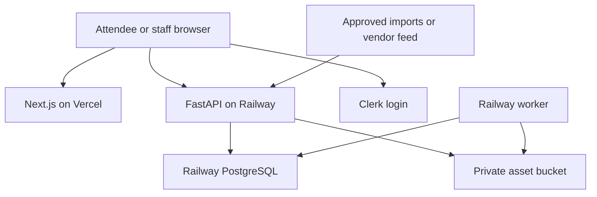

# Courtside Connected — MVP Technical Implementation

**Version:** 1.0 · 17 October 2026  
**Scope:** Mobile-first web application, with progressive web app enhancements after core functionality.  
**Decision:** Next.js/Vercel frontend; FastAPI/PostgreSQL/Railway backend.  
**Status:** Implementation specification, not a deployed application.  
**Precedence:** This document controls the MVP scope and stack. OVA_Technical_Product_Catalogue.md defines the broader product roadmap; OVA_Preliminary_Research.md contains research and the expanded Smoothcomp assessment.

## 1. Delivery objective

Build the shortest complete useful journey: an attendee opens an event link, follows teams, finds the next match and court, sees official changes and finds venue services. Staff can import an approved schedule, review changes, publish announcements and maintain approved team/event information.

Use Smoothcomp's next-match focus, persistent following, clear status filters and contextual detail panels as product references. Do not build a tournament scheduler. Competition sources remain authoritative. The first release uses approved CSV imports and controlled staff content; live vendor connectors are separately gated by access and sample-data validation.

### MVP feature boundary

| Feature | First release | Later |
|---|---|---|
| Event dashboard and guide | Event, venue, parking, accessible directions, food and help | Advanced interactive indoor navigation |
| Teams and following | Search, guest local follows, optional account synchronization | Clubs/divisions as additional follow targets |
| My Day | All followed teams, next match, overlap warnings | Source-backed travel/queue intelligence |
| Match centre | Published schedule/result, status, source/freshness, change badges | Validated live point feed or official ETA |
| Updates | Durable in-app inbox for accounts; contextual event/team change feed for guests | Email/push and delivery monitoring |
| Team profiles | Approved display roster/photo, visibility controls | Automated MRS synchronization |
| Calendar | One-time ICS download, labeled snapshot | Subscription feed, then Google OAuth |
| Merchandise/sponsors | Approved cards, booth location and merchant links | Inventory, checkout or pickup integrations |
| Coach/referee | Verified role views, briefing and authorized links; approved assignment import only if available | Coach coverage board and assignment connector |
| Admin | Event content, CSV preview/commit, announcements, audit/source health | Additional competition connectors and richer reporting |

Guest users must be told that local preferences stay on the current device. A fan following a team is not a verified guardian or coach. Prototype records and simulated changes must be clearly labeled.

## 2. Final technology stack

| Layer | Selected technology | Responsibility |
|---|---|---|
| Frontend | Next.js App Router + React + TypeScript | Responsive attendee and admin screens |
| UI | Tailwind CSS + shadcn/ui + Lucide icons | Accessible reusable controls and consistent layout |
| Server state | TanStack Query | API fetches, caching, invalidation and conditional polling |
| Forms | React Hook Form + Zod | Client form validation; backend independently validates |
| API | Python + FastAPI + Pydantic | Domain rules, imports, authorization and REST API |
| Backend hosting | Railway API service | Public HTTPS API; persistent application process |
| Database | PostgreSQL on Railway | Application state, revisions, audit and durable jobs |
| Persistence | SQLAlchemy 2 + psycopg + Alembic | Database access and versioned migrations |
| Authentication | Clerk Next.js SDK + Python backend SDK | Hosted login/session issuance and backend token verification |
| Authorization | FastAPI policy dependencies + PostgreSQL role grants | Organization/event/team access decisions |
| Files | Railway private S3-compatible bucket + boto3 | Approved non-sensitive assets and short-lived upload/download URLs |
| Background processing | Separate Railway worker, same Python package | Import jobs, change fanout and later external deliveries |
| Job persistence | PostgreSQL jobs/outbox tables | Durable leased work without introducing Redis initially |
| Frontend hosting | Vercel | GitHub-connected builds and previews |
| Version control / CI | GitHub + GitHub Actions | Locked dependencies, checks, build and migration validation |
| Calendar | Python iCalendar library or standards-compliant serializer | ICS snapshots with stable match identity |
| Verification | pytest + Playwright | Domain/data correctness and complete user journeys |

Pin maintained, mutually compatible releases in lockfiles during implementation; avoid copying old SDK method signatures without checking the installed version. No Supabase services or client packages are part of this design.

Railway is infrastructure, not an automatic replacement for Supabase Auth or its generated data APIs. Clerk supplies authentication; FastAPI supplies APIs and authorization; the worker supplies reliable processing; the frontend initially polls the API rather than subscribing directly to PostgreSQL. This choice fits the team's existing FastAPI/Railway experience.

## 3. Deployment layout and request flow



Use one GitHub monorepo and two application deployments: Vercel web and Railway API. The worker is a second Railway service built from the backend package with a different start command. PostgreSQL and assets are separate infrastructure resources in the same scoped Railway project/environment.

The browser calls the Railway HTTPS API directly with an ephemeral Clerk bearer token for protected operations. Public read endpoints need no token. Configure an explicit CORS origin list for production, staging and local development; never allow every Vercel preview origin to write production data. Authorized preview deployments target staging services.

Next.js Server Actions/Route Handlers may support presentation needs or auth-provider callbacks, but they do not own duplicate domain logic or database connections. FastAPI is the authoritative application backend. Vercel cannot access Railway private service hostnames; only Railway API/worker use the private database address. Never expose database credentials to the browser.

## 4. Repository and modules

| Path | Contents |
|---|---|
| apps/web/app | Event/team/match routes, My Day, Updates, guide, login, admin |
| apps/web/components | MatchCard, FollowButton, MatchSheet, FilterSheet, FreshnessBadge, VenueCard, ImportPreview |
| apps/web/lib | API wrapper, query keys, auth-token access, local follows and date formatting |
| services/api/app/main.py | FastAPI app, middleware, routers and health endpoints |
| services/api/app/core | Configuration, auth verification, policy checks and logging |
| services/api/app/models | SQLAlchemy entities and constraints |
| services/api/app/schemas | Public/private response models and input models |
| services/api/app/modules | events, teams, matches, follows, updates, content, imports, media, assignments |
| services/api/app/adapters | CSV adapter and future authorized source adapters |
| services/api/app/worker.py | Durable worker entry point |
| services/api/alembic | Reviewed schema migrations |
| services/api/tests | Integration tests with disposable PostgreSQL |
| tests/e2e | Playwright parent, guest, coach and admin flows |
| docs | Data contract, local setup, deployment and event runbook |

Generate TypeScript API types from FastAPI's OpenAPI schema in CI. Keep all source-specific parsing inside adapters; page components should only know canonical team and match entities.

## 5. Database design for the first release

Use UUID primary keys, TIMESTAMPTZ timestamps, explicit foreign keys and organization/event scope. Generate UUIDs in application code to avoid requiring a database extension for the MVP.

| Table | Required columns and constraints |
|---|---|
| organizations | id, name; single initial organization with explicit scope |
| users | id, clerk_subject UNIQUE, created_at, disabled_at |
| role_grants | user_id, organization_id, event_id nullable, team_id nullable, role, granted_by, expires_at; valid scope checked |
| events | id, organization_id, title, timezone, start_date, end_date, status, revision |
| venues / courts | venue event relationship, address, approved map/info; court has venue_id and label; UNIQUE(venue_id,label) |
| teams | id, organization_id, season, club_name, name, approved_logo_asset_id |
| event_entries | id, event_id, team_id, division_label; stable event participation |
| sources | id, event_id, name, mode, official_url, expected_check_interval, last_successful_check_at |
| external_mappings | source_id, entity_type, external_id, canonical_id; UNIQUE(source_id,entity_type,external_id) |
| matches | id, event_id, source_id, external_id, court_id, scheduled_start, estimated_start nullable, status, revision, source_revision nullable, source_updated_at nullable, observed_at, result_state |
| match_participants | match_id, slot, event_entry_id nullable, placeholder_label nullable; UNIQUE(match_id,slot) |
| set_results | match_id, set_number, home_score, away_score; scores nullable; UNIQUE(match_id,set_number) |
| follows | user_id, event_entry_id; UNIQUE(user_id,event_entry_id) |
| announcements | id, event_id, team scope nullable, category, title, body, state, publish_at, expire_at, revision |
| venue_content / partner_cards | event/venue scope, content type, approved fields, links, validity and revision |
| roster_publications | event_entry_id, version, approved public JSON, publication_state, consent_review_ref, reviewed_by |
| assignments | event_id, person_user_id, match_id nullable, role, reporting_time, source_id, revision; restricted API |
| assets | id, object_key, classification, mime, size, checksum, state, uploader, publication_revision |
| import_batches / import_rows | source_id, hash, state, expected_source_revision, staged diff, errors, actor, timestamps |
| change_events | event_id, entity_id, entity_revision, event_type, allowlisted diff, occurred_at; unique entity/revision/type |
| inbox_items | user_id, change_event_id, read_at; UNIQUE(user_id,change_event_id) |
| jobs | id, type, payload, dedupe_key UNIQUE, state, run_after, attempts, lease_owner, lease_until, last_error |
| audit_entries | actor, action, event_id, target, old/new revision, request_id, created_at; redact sensitive data |

Indexes: event/time on matches; entry-to-match participants; user follows; user/inbox timestamp; ready jobs by state/run_after; source external IDs. Source IDs are scoped to an event/source. Do not use fuzzy team-name matching to publish or send personalized changes.

MVP rosters contain only pre-approved public fields; do not ingest birthdates, contact details, eligibility evidence or consent originals. Store a reference to the approved publication decision. If that cannot be established, show team information without individual athletes.

## 6. Authentication and authorization

1. Use Clerk's ready-made frontend login; no attendee login is required for browsing or local follows.
2. Protected browser calls obtain a current session token and send Authorization: Bearer. Do not persist bearer tokens in localStorage.
3. FastAPI uses the current Python SDK to verify signature, expiry, issuer and allowed parties; accept session tokens only on user-facing endpoints. Configure expected audience if the selected token contract requires it.
4. Resolve the verified subject to a local user id. Upsert idempotently; signed webhooks can reconcile deletion/disable events. New users receive no staff grants.
5. Authorize every write and private read using current database grants with event/team scope and expiry. Frontend route protection alone is insufficient.
6. Provision the first administrator through a controlled backend management command tied to a verified Clerk subject. Never expose a public “make admin” endpoint or grant staff privileges from user-editable profile metadata.

Guests store only canonical followed entry IDs and private local labels. On sign-in, offer an idempotent merge into account follows. On sign-out, clear private cached responses and query state; let the user choose whether public guest follows remain.

Coach/referee roles require approved grants. Coaches see their scoped team operations; officials see their own imported assignments. Selecting a role during onboarding changes navigation only until verified.

## 7. API and frontend contract

All routes below are proposed companion endpoints, not vendor APIs. Prefix with /v1. Separate public response schemas from private models; never serialize a whole ORM entity by default.

| Method and path | Function | Access |
|---|---|---|
| GET /events | Discover available events | Public |
| GET /events/{event_id} | Event metadata and freshness | Public |
| GET /events/{event_id}/teams | Search entries by team/club/division | Public |
| GET /events/{event_id}/matches | Cursor-paginated status/team/court/date filters | Public |
| GET /matches/{match_id} | Detail, result and source metadata | Public approved projection |
| GET /events/{event_id}/changes | Revision-based public change feed | Public; only public diffs |
| GET /events/{event_id}/guide | Venue/content/partners | Public |
| GET /events/{event_id}/calendar.ics | Selected public matches snapshot | Public; bounded validated filters |
| GET /me/follows | Account follows | Owner |
| PUT or DELETE /me/follows/{entry_id} | Idempotent follow/unfollow | Owner |
| GET /me/inbox | Personal inbox | Owner |
| PATCH /me/inbox/{id} | Set read timestamp | Owner |
| GET /me/assignments | Current authorized official assignments | Scoped official |
| POST /admin/imports | Validate and stage CSV | Scoped operator |
| GET /admin/imports/{id} | Errors and staged diff | Scoped operator |
| POST /admin/imports/{id}/commit | Atomic authorized commit | Scoped publisher; expected revision |
| POST/PATCH /admin/content | Edit event/partner/venue content | Scoped editor |
| POST /admin/announcements/{id}/publish | Publish reviewed notice | Scoped publisher |
| POST /admin/assets/upload-url | Restricted staged object upload | Scoped staff |
| POST /admin/assets/{id}/finalize | Validate uploaded bytes | Scoped staff |
| GET /health/live and /health/ready | Process health and DB readiness | Minimal public response; no secrets |

Use 401 for invalid identity, 403 for forbidden actions, 409 for stale revision/import conflict, 422 for validation and 503 for unavailable dependencies. An outage must not return an empty successful schedule. Rate-limit public reads/imports and bound result sizes. Mutation endpoints record a request ID and use idempotency keys where retrying could repeat a commit.

Example response envelope (synthetic):

```json
{
  "data": [{"id":"demo-match-1","status":"scheduled","revision":4}],
  "next_cursor": null,
  "event_revision": 17,
  "source": {
    "mode":"manual_import",
    "last_checked_at":"2026-10-17T14:00:00Z",
    "upstream_updated_at":null,
    "freshness":"imported_snapshot"
  }
}
```

In CSV mode show “Imported at …”, not “Live.” Keep source publication time, import observation time and successful check time distinct. Fast page polling cannot make an old CSV current.

## 8. Smoothcomp-inspired frontend behaviour

**Routes:** /events/[eventId], /events/[eventId]/my-day, /events/[eventId]/teams, /teams/[entryId], /matches/[matchId], /events/[eventId]/guide, /updates and /admin. Preserve the selected event in all transitions. Public deep links must work without cached state.

**NextMatchCard:** Shows earliest non-cancelled/non-completed followed match with a resolved start. Also show an “Awaiting schedule” item for unresolved matches rather than dropping them. Include team/opponent, day, venue/court, scheduled/estimated label and last checked/imported time.

**Match browser:** Upcoming/In Progress/Results, venue/court/division filters, query in URL and a reset control. Only confirmed source status populates In Progress. Keep unmatched/unknown states discoverable through All.

**My Day:** Aggregate followed entries; deduplicate a match where two followed teams play each other. Show one conflict group for overlapping matches. Estimated end times and configurable transfer buffers are labeled assumptions; do not read personal calendars to identify these overlaps.

**MatchSheet:** Bottom sheet on phones, side panel on desktop, with focus management and keyboard dismissal. Include a normal detail-page route for direct links and accessibility. Use text directions alongside maps.

**Fetching:** TanStack Query keys include event, filters and authenticated user where applicable. Poll visible active-event data initially every 30 seconds; pause in background/offline and revalidate on focus/reconnect. Use ETag/If-None-Match on public endpoints. Do not create one vendor fetch per browser poll.

**PWA:** First ship responsive web. Then add manifest and carefully scoped service-worker caching of public app assets and event essentials. Exclude authenticated APIs, inbox, private assignments, admin pages, tokens and signed object URLs. Mark saved data offline and expire it. Native lock-screen Live Activities are out of this release.

## 9. CSV ingestion and source adapters

Start with a documented app-owned interchange schema rather than guessing a vendor export. Required match fields: external_match_id, external_event_id, division, scheduled_start with offset or declared event timezone, venue_id, court_id, home_entry_id, away_entry_id (nullable only with a placeholder), status. Optional source_revision, source_updated_at and set results. Separate team/venue mapping imports precede matches.

1. Upload UTF-8 CSV with a proposed 5 MB / 10,000-row limit; reject malformed encoding, unknown columns when strict mode is enabled, invalid dates and oversized cells.
2. Validate identifiers against the selected event/source and reference tables. Stage unresolved mappings for review; never silently create a team from a similar name.
3. Record file hash and parse results. Preview additions, changes, unchanged rows, explicit cancellations and errors.
4. Treat imports as partial by default. A missing row never cancels a match. Complete snapshots require an explicit mode and review of proposed removals.
5. Commit only a validated batch in one transaction, with a lock/expected source generation to detect concurrent changes since preview. Save normalized revisions, audit and change events together.
6. Enqueue fanout jobs in that transaction. Identical file or unchanged row replay does not create new alerts.
7. Record actor/import time and expose it in freshness metadata.

Define a small adapter protocol: fetch_or_parse, validate, map_identifiers, normalize, capability_metadata and reconcile. Authorized AES/TIMU/MyTeam.Click adapters can implement it later. Version each adapter and test cancellation, correction, partial response, outage and recovery. Public page visibility is not assumed to grant extraction/republication rights.

## 10. Durable jobs and updates

Use a PostgreSQL job table to avoid adding a broker in the first version. The worker claims ready rows with SELECT FOR UPDATE SKIP LOCKED, assigns a lease, then releases the database transaction before performing long work. On success mark complete; on failure increment attempts and retry with bounded exponential backoff/jitter. Recover expired leases after crashes. Cap attempts and expose failed jobs to staff.

Fanout uses a unique (user_id, change_event_id) constraint. Repeated jobs create no duplicate inbox records. Do not backfill every historical change when someone follows a team; show current state and new changes after following unless they explicitly request history. Recheck current follow/preferences before optional external sends.

Account users receive durable personal inbox items. Guests receive the public change feed filtered locally by followed entries. A guest's “read” marker is local only. Do not imply cross-device persistence without an account.

External email/push can be added behind separate jobs and category preferences. Exactly-once sending is not assumed: a provider timeout can be ambiguous. Use provider idempotency where available, stable delivery IDs, reconciliation and visible status. Notifications cannot guarantee arrival or act as the sole emergency channel.

## 11. File handling and storage

Use Railway buckets for approved non-sensitive media with private credentials. Staff request a short-lived upload URL for an application-generated object key, then finalize. Finalization checks actual bytes, size, MIME signature and checksum; decode/re-encode allowed raster images, strip metadata and create bounded derivatives. Do not allow arbitrary HTML/SVG or public execution of uploaded files. Unvalidated objects remain quarantined and unavailable to public endpoints.

Railway currently documents private buckets, presigned access and limitations including no object versioning or server-side encryption feature. Do not assume every AWS S3 feature is supported. Sensitive roster/consent originals are excluded from MVP uploads. Later confidential files require a reviewed encrypted storage/key-management approach. Database and bucket backup/retention must be configured explicitly.

Public assets are accessible only after a current publication/consent check. Return a short-lived presigned GET (proposed 60-second TTL) or proxy through a scoped asset endpoint. Presigned URLs remain usable until expiry even after a permission change; disclose and test that revocation bound. Avoid permanent public CDN caching for youth photos. On withdrawal stop issuing URLs immediately, remove derivatives as policy requires and invalidate application caches.

For the fastest demo, put licensed venue graphics and synthetic team logos in the web repository and omit individual youth photos entirely. Merchant links must be approved HTTPS URLs with clear seller/refund ownership. No card data is processed.

## 12. Configuration and deployment specification

### Environment variables

| Service | Variable | Notes |
|---|---|---|
| Vercel web | NEXT_PUBLIC_API_BASE_URL | Public HTTPS Railway API URL |
| Vercel web | NEXT_PUBLIC_CLERK_PUBLISHABLE_KEY | Public auth-provider key |
| Vercel web | CLERK_SECRET_KEY | Server-only if required by Next.js auth integration |
| Railway API/worker | DATABASE_URL | Railway private PostgreSQL reference; adapt driver scheme for SQLAlchemy/psycopg |
| Railway API | CLERK_SECRET_KEY or configured JWKS verification settings | Server-only; choose supported SDK verification mode |
| Railway API | CLERK_AUTHORIZED_PARTIES / CORS_ALLOWED_ORIGINS | Exact JSON/list values parsed by configuration; no wildcards for privileged origins |
| Railway API | AUTH_ISSUER | Expected Clerk instance; validate contract against SDK |
| Railway API/worker | S3_ENDPOINT_URL, S3_BUCKET, S3_ACCESS_KEY_ID, S3_SECRET_ACCESS_KEY, S3_REGION | Actual returned bucket values; never assume AWS endpoints |
| Railway API | APP_ENV, PUBLIC_WEB_URL, LOG_LEVEL | Environment and safe links |
| Railway API | PORT | Runtime-provided; listen on all interfaces |
| Railway worker | WORKER_ID, JOB_POLL_SECONDS, JOB_MAX_ATTEMPTS | Unique worker identity and bounded processing |

Do not place secrets in NEXT_PUBLIC variables. Do not copy Eng Academi production keys, user tables or storage into this separate MVP. Use separate staging/production auth applications or supported isolated configuration and separate databases/buckets.

### Concrete deployment sequence

1. Create the repository, scaffold Next.js and FastAPI, lock dependencies, add a local PostgreSQL development service and synthetic seed dataset.
2. Configure Clerk development auth and verified backend identity. Implement local staff bootstrap and permissions before adding admin import/publish endpoints.
3. Provision a scoped Railway project/environment with API, PostgreSQL and worker services; optional asset bucket only when uploads are enabled.
4. Connect API/worker to private PostgreSQL using reference variables. Keep the database private. Expose only the API through HTTPS.
5. Build a backend Docker image from a maintained pinned Python base; install locked dependencies and run as a non-root user. Use the same image for API and worker.
6. Run Alembic migrations as one controlled pre-deploy step. Use a database advisory lock or a single designated migration job to prevent concurrent migration execution. Do not run migrations from every API replica.
7. API start command: uvicorn app.main:app --host 0.0.0.0 --port "$PORT". Worker: python -m app.worker. Configure readiness at /health/ready, restart behaviour and resource limits. One API replica/worker is sufficient for a limited initial demo, subject to load validation.
8. Configure backups explicitly and perform a restore rehearsal before live event use. Use backward-compatible expand/contract migrations so code rollback remains possible.
9. Deploy apps/web to Vercel, set API/auth variables and link GitHub previews to staging. Add exact frontend origins to API CORS and token verification settings.
10. Seed approved pilot content through the admin import. Smoke-test role access, changed schedule, source freshness and assets on deployed iOS/Android browsers.

These are implementation steps, not actions performed in this documentation task. Do not infer automatic failover, point-in-time recovery or a particular service region from merely creating a PostgreSQL service; select and test the required capabilities.

## 13. Fast build sequence and realistic estimate

Assume two developers already comfortable with Next.js and FastAPI, access to deployment accounts, and prepared synthetic/approved CSV data. Dependencies can extend the schedule. A demo and live event release have different acceptance gates.

| Day | Working increment | Completion test |
|---|---|---|
| 1 | Repo, web shell, API, PostgreSQL migrations, auth and staged deployments | Public event and protected /me work end to end |
| 2 | Event/team/match data, CSV staging and commit | Valid CSV populates schedule; invalid/duplicate rows handled correctly |
| 3 | Next Match, following, My Day, filters and match detail | Guest follows two teams and finds both courts |
| 4 | Admin announcements, change events, worker and Updates | Court change appears once; restart worker without data loss |
| 5 | Venue guide, approved roster display, merchandise/sponsors and ICS | Complete attendee journey with external merchant handoff |
| 6–7 | Scoped coach/referee view, mobile/accessibility checks, failure fixes | Cross-role access denied; offline/stale and timing states clear |
| 8–10 | Buffer, deployed tests, staff walkthrough and pilot preparation | Agreed launch gates pass |

Target 3–5 days for a demonstrator and approximately 7–10 working days for this narrow functional MVP under these assumptions. A live championship pilot can require substantially more integration, privacy, staffing and reliability work. Do not treat the ten-day sequence as a production-service commitment.

If time is shorter, preserve guest search/follow, My Day, admin CSV commit, venue guide and honest update state. Use pre-approved team content and merchant links. Optional accounts and richer role workflows can follow the demonstrated core journey, but no public sensitive-data feature launches without its permissions.

## 14. Acceptance and verification

- Guest can follow two entries, refresh and retain local choices; sign-in merge is idempotent.
- My Day deduplicates a match involving two followed teams and warns on overlapping assumed match windows.
- Missing score remains unknown; scheduled time passing does not create a live status.
- Duplicate CSV commit/retry creates no duplicate matches, change events or inbox entries.
- Preview conflict is rejected if source state changes before commit. Missing rows in partial imports do not cancel matches.
- Worker crash after claiming a job recovers via lease; recipient deduplication survives replay.
- Spectator/coach/sponsor cannot retrieve unapproved private roster or another official's assignments through guessed IDs.
- Invalid/expired/wrong-issuer tokens fail; user-editable role data never grants privilege.
- Public assets require approved publication; withdrawn assets stop receiving new download URLs, with the documented residual URL TTL.
- ICS export uses stable UID/revision and correct timezone conversion, but is visibly identified as a snapshot.
- Test keyboard/screen reader, 200% zoom, small phones and tablet layouts on core flows. Provide text alternatives to venue maps and non-colour status indicators.
- Test source unavailability, API downtime, slow venue network and foreground/reconnect refresh. Do not show empty data as a successful response to a failed source.
- Run pytest domain/integration checks, frontend type/build checks and a small Playwright flow across guest/admin permissions. Use disposable PostgreSQL rather than SQLite to test concurrency, constraints and leasing.

Monitor request error rate, read latency, import failures, source freshness, job age/retries and failed permission checks with redacted structured logs. Establish baseline traffic before claiming large-event capacity. Never log bearer tokens, signed URLs, private rosters or file credentials.

## 15. Future mobile application and extensions

The first product is web, usable on phones/tablets/desktops. Later React Native/Expo clients can consume the same FastAPI contracts and Clerk identity. Share domain types/design tokens where practical; Next.js DOM components do not automatically become native components.

Add native lock-screen functionality through its actual platform APIs only when user value justifies it. Add approved vendor connectors, calendar subscriptions, external notifications, coach coverage and commerce adapters incrementally. Predictive ETAs, video production and scheduling engines remain separate projects.

## 16. Evidence and open decisions

The stack, schema and delivery sequence are proposed design. Official documentation verifies the relevant platform capabilities; no vendor integration or authenticated Smoothcomp performance was tested.

| Reference | Use |
|---|---|
| [Railway FastAPI guide](https://docs.railway.com/guides/fastapi) | Supported backend deployment path |
| [Railway PostgreSQL](https://docs.railway.com/databases/postgresql) | Provisioning, private connection variables and explicit backup/HA choices |
| [Railway buckets](https://docs.railway.com/storage-buckets) | Private S3 storage and capability limitations |
| [Railway file serving](https://docs.railway.com/storage-buckets/uploading-serving) | Presigned uploads/downloads |
| [Clerk Python backend](https://clerk.com/articles/how-to-add-authentication-to-a-python-backend) | Frontend session acquisition and Python verification |
| [Clerk session tokens](https://clerk.com/docs/guides/sessions/session-tokens) | Token claims and validation context |
| [Smoothcomp My Matches](https://support.smoothcomp.com/article/90-find-out-your-dynamic-starting-timeWEIGH-INSAll) | Next-match and multi-profile experience |
| [Smoothcomp match discovery](https://support.smoothcomp.com/article/75-find-out-who-is-fighting-right-now) | Status filters and contextual navigation |
| [Smoothcomp scheduler](https://support.smoothcomp.com/article/310-new-scheduler) | Explicit staging/publish patterns |
| [Smoothcomp/Gymdesk announcement](https://smoothcomp.com/en/about/smoothcomp-gymdesk) | New coaching/recording ecosystem context |

Before coding confirm: pilot event and content owner; allowed roster fields; source CSV contract; staff approval process; exact auth-provider plan; hosting region/capabilities; merchant links; supported languages; expected traffic and event support owner. Most initial implementation can proceed with synthetic fixtures while those decisions are resolved.
