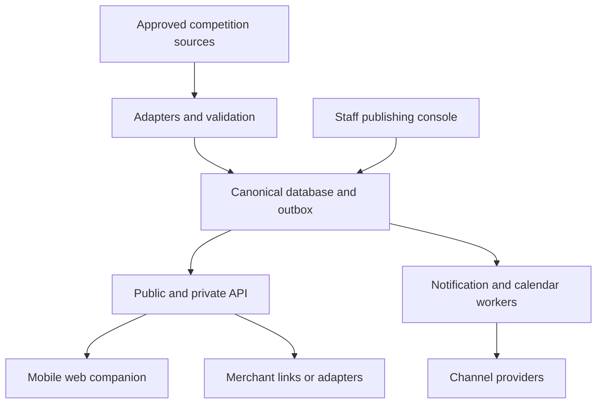

# Courtside Connected — Technical Product Catalogue

**Version:** 0.2 — proposed design, 17 October 2026 UTC  
**Audience:** OVA stakeholders, product designers, developers and pilot operators  
**Companion document:** OVA_Preliminary_Research.md  
**Implementation status:** Specification only. No integrations, production services or supplier agreements are represented as implemented.

**MVP implementation decision:** Use Next.js/TypeScript/Tailwind/shadcn on Vercel, FastAPI and PostgreSQL on Railway, SQLAlchemy/Alembic, Clerk authentication and a durable PostgreSQL-backed worker. Use approved non-sensitive asset storage with Railway's documented private-bucket limits. The controlling build scope and implementation details are in **OVA_MVP_Technical_Implementation.md**. This catalogue describes the wider roadmap; features marked P0 here can be simplified or staged according to that MVP plan. The preliminary research now includes an extensive Smoothcomp adaptation review.

## 1. Product contract

Courtside Connected assembles authorized OVA event information into a personalized mobile experience, with tools for staff to publish content and resolve integration exceptions. Its initial customer is an event organizer; its primary attendee persona is a parent or guardian following one or more teams.

**Promise:** “Your teams, your next match, your event—in one place.”

**Trust contract:** Show where information came from, when it was checked, whether it is provisional, and what is unavailable. A fast interface must never imply a faster or more complete upstream source than exists.

**Authority contract:** Existing competition systems determine schedules, official results, standings and progression. Existing membership systems determine roster eligibility. Courtside Connected determines preferences, content presentation, consent-controlled publication, notification subscriptions and its own delivery records.

### Release terminology

| Phase | Meaning | Exit condition |
|---|---|---|
| D — Demonstrator | Synthetic data and simulated changes, clearly labeled | Complete end-to-end presentation journey |
| P0 — Pilot | One event, one authorized competition source, limited staff | Data access, security, accessibility, support and rehearsal gates passed |
| P1 — Expansion | More sources and richer operational/commerce workflows | Measured pilot benefit and stable source contracts |
| P2 — Optional | Native apps, broader federation offering, assisted search | Independent business case and sustained support capacity |

P0 includes lightweight versions of merchandise and coach/referee information. Assignment synchronization, checkout and Google OAuth calendar synchronization are later capabilities. Dates depend on vendor access; they are not delivery commitments.

## 2. Information architecture and key journeys

**Mobile navigation:** My Day · Teams · Event Guide · Updates · More. “More” contains calendar settings, account, help, accessibility preferences and partner information. Merchandise also appears in Event Guide and in relevant venue locations. Public event landing pages remain available without selecting a role.

**Desktop:** Same information model; wider itinerary and venue panes. Staff use a separate authenticated workspace. Avoid maintaining unrelated mobile and desktop content trees.

**Parent journey:** Open QR link → select event → follow teams → see consolidated matches → open court/venue details → optionally enable alerts and calendar → review any changed time/court. No child's identity is necessary to follow a public team.

**Coach journey:** Verify club/team role → review imported roster publication fields → resolve missing permissions → approve an event-specific version → receive relevant official instructions. Approval does not alter upstream eligibility.

**Referee journey:** Open event briefing → authenticate for private assignments if an authorized feed exists → view court, reporting time and assignment revision → acknowledge important notices. Public users cannot see private personnel assignments.

**Staff journey:** Configure event and source → review mapping/import exceptions → publish event content → inspect source health → issue targeted notice → track delivery creation and failures → close/archive event.

## 3. Product catalogue

Each entry describes intended behaviour, dependencies and minimum acceptance. Numeric thresholds are proposed pilot targets unless explicitly identified as source requirements.

### CC-01 — Event discovery and guest access

**Users / phase:** Everyone; D/P0.

- Event landing pages with dates, venue/city, division filters, official contact and accessibility information.
- QR/deep links open a specific event, team or match; preserve the destination through optional authentication.
- Guest team preferences stored locally; explicit migration to an account when the user chooses sign-in.
- Search distinguishes club, season, age group, competition category and team label. Never display two same-name teams as interchangeable.
- Empty states explain “schedule not yet published,” “no matching teams,” or “source unavailable” separately.

**Dependencies:** Approved event/team index; stable public IDs.  
**Acceptance:** A first-time visitor can find and follow a team without signing in. An invalid link offers event search without revealing internal identifiers. Guest preferences on a shared device can be cleared.

### CC-02 — Following and family itinerary

**Users / phase:** Parents, spectators, athletes; D/P0.

- Follow multiple teams/divisions; assign optional personal labels, stored privately.
- My Day sorts matches chronologically with venue, court, source status and changed-field badges.
- Flag overlapping matches and different-venue travel conflicts using configurable travel buffers. These are warnings, not navigation guarantees.
- Show scheduled time versus a source-provided estimated time as distinct fields. Never derive a precise start countdown from stale data.
- “Next” excludes cancelled/completed matches; pending playoff slots remain TBD until the official source resolves them.
- Shared links expose public team/event pages, not household preferences or private calendars.

**Dependencies:** Canonical match/team mappings; event timezone.  
**Acceptance:** Two followed teams with overlapping matches yield one clear conflict warning. A source correction moves the match without duplicating it. A cancellation disappears from “Next” but remains in update history.

### CC-03 — Match centre, results and standings

**Users / phase:** Everyone; D/P0.

- Match detail: teams, round/pool/division, scheduled time, court/venue, match status, set scores when supplied, official result, source link and freshness.
- Allow statuses `unpublished`, `scheduled`, `delayed`, `in_progress`, `completed`, `cancelled`, `postponed`, `unknown`; retain raw source status for traceability.
- Separate status from result verification. A completed match can have a pending or corrected result.
- Display official standings/brackets when licensed and technically available; otherwise provide a contextual link. Do not silently reproduce tie-break rules.
- Report-a-discrepancy routes a structured report to staff; it never changes the score automatically.

**Dependencies:** Source capabilities and publication cadence.  
**Acceptance:** Missing score is not shown as 0–0. An older payload cannot overwrite a newer verified revision. Corrected results carry a correction label and create one new change event. No “live points” label without a validated point feed.

### CC-04 — Notification centre and subscriptions

**Users / phase:** Followers and staff; D/P0.

- In-app inbox is the primary durable record; optional supported web push and email extend it.
- Categories: schedule/court changes, published results, event operations, coach/referee notices and optional commercial messages.
- Preferences are scoped by event/team/channel. Users can pause a team, select a digest or set quiet hours.
- Change templates show old → new values, affected team, event, effective time and canonical link.
- Deduplicate by recipient, match/content revision, channel and template version. Repeated identical imports generate no new alert.
- Schedule reminders recheck the latest revision before dispatch; obsolete reminders are cancelled.
- Critical notices require authorized publishers, expiry, preview of target count and an audit record. Push is not an emergency alert system and cannot override operating-system settings.

**Dependencies:** Verified addresses, channel credentials, consent and transactional outbox.  
**Acceptance:** Replaying an import creates one inbox entry. A last-minute court change invalidates the old reminder. Unsubscribing immediately suppresses newly queued optional sends. Provider acceptance is distinguished from actual reading or guaranteed delivery.

### CC-05 — Calendar products

**Users / phase:** Parents, coaches, referees; snapshot/subscription P0, Google integration P1.

| Variant | Behaviour | Limitation made visible |
|---|---|---|
| Download .ics | Export selected matches once | Snapshot will not automatically update |
| Subscribe to calendar | Stable feed with match UIDs and revisions | Calendar-client refresh cadence is outside our control |
| Connect Google Calendar | Create/update owned events in a dedicated calendar | Requires OAuth and active authorization; delays/failures surfaced |

Use UTC internally and an IANA event timezone for display. Calendar output includes stable `UID`, `DTSTAMP`, incrementing `SEQUENCE`, start/end and cancellation status as supported by the client. If end time is estimated, label it estimated. Protect private feeds with revocable high-entropy tokens, redact tokens from logs and return `Cache-Control: private` where appropriate.

Google integration stores `(user, calendar, canonical_match, google_event_id, synced_revision)` mappings. Update app-owned entries rather than repeatedly inserting. Use ETags/concurrency checks and reconcile ambiguous timeouts before retrying inserts. Disconnect stops writes and offers removal of app-created events; it must not delete unrelated personal calendar content. Inbound synchronization, if enabled, follows Google's incremental-sync contract and handles invalid tokens [T2–T3].

**Acceptance:** A time change updates the same calendar identity; a cancellation does not leave an active duplicate. Revoked OAuth produces an actionable reconnect state. Test subscription behaviour separately in Apple, Google and Outlook; never promise immediate refresh across clients.

### CC-06 — Venue and event guide

**Users / phase:** Everyone; D/P0.

- Court directory scoped to venue and event, searchable maps, entrance/parking/transit links, food, washrooms, water, accessibility routes, first aid and help desk.
- Prefer an accessible HTML location list with optional annotated map. A visual PDF alone is insufficient.
- Content includes owner, verification date, validity window, venue scope and approval status.
- Cache approved public essentials and show the saved timestamp offline. Clearly distinguish cached notices from current conditions.
- Outdoor/beach events support weather-related official notices and relevant venue details. Staff, not a weather model, determine official play suspension.

**Acceptance:** Court 3 in two venues is never ambiguous. Each map destination has a text equivalent. A changed venue restriction expires the old content. A no-network test can open previously downloaded essential information.

### CC-07 — Roster publication and team profiles

**Users / phase:** Club managers, OVA editors and spectators; basic approved import P0, upstream connector P1.

- Import only authorized roster fields from MRS or an approved export; first verify the real workflow.
- Keep eligibility source records separate from the public event roster projection.
- Candidate public fields: approved display name, jersey number, position and approved team image. Exact disclosure policy is an OVA decision.
- Private fields and original photos remain outside public API projections. Strip image metadata and create approved-size derivatives after malware/file validation.
- Track consent purpose, subject, authorized decision-maker, evidence reference, policy version, scope and withdrawal status. A checkbox from an unrelated staff member does not establish guardianship.
- Workflow: `draft → submitted → review_required/approved → published → superseded/withdrawn`. Publication requires permission and complete field-level checks.
- Enforce seasonal/event roster locks as read-only publication constraints; request eligibility corrections from the authoritative system.

**Acceptance:** Missing publication permission blocks the affected athlete record rather than exposing it. Withdrawal removes live public derivatives and invalidates caches; retain required private audit evidence only under approved retention policy. The same roster version cannot be re-published with withdrawn permission.

### CC-08 — Coach workspace

**Users / phase:** Verified coaches/managers; basic P0, richer feed P1.

- Team-specific official instructions, roster review, check-in requirements, venue/wave details and notice acknowledgements.
- Role assignment through OVA/club approval, scoped by event/team and expiry; selecting “coach” during onboarding grants no privilege.
- In P0, link to the established check-in workflow. Later display authorized completion status without becoming the registration system.
- Team work-duty assignments may be displayed if supplied, clearly separate from match participation and referee assignments.

**Acceptance:** A coach for Team A cannot access Team B's private roster. Expired membership/role access is removed. Acknowledging a notice records version and timestamp; later revisions require a new acknowledgement where configured.

### CC-09 — Referee and volunteer information

**Users / phase:** Officials/volunteers; public briefing P0, assignments P1.

- Public event briefing and contact information; private assignment list only after authorized import and role verification.
- Assignment fields: person reference, match, court, reporting time, role, source revision and acknowledgment; details must match the source owner.
- “Request correction” creates an operational exception; no self-reassignment or unofficial swap.
- Assignment conflicts flag overlap for review; do not automatically schedule officials.

**Acceptance:** Spectators cannot enumerate officials' personal schedules. Changed assignments retain revision history. Missing assignment data is shown as unavailable, not as “no duty.”

### CC-10 — Merchandise and tickets

**Users / phase:** Attendees/vendors; discovery and hosted links D/P0, integrated orders P1.

- Product cards with seller, image, category, booth/pickup location and merchant link. Display price/availability only when maintained by the merchant or a verified feed.
- External checkout identifies the merchant and opens its hosted experience; no card details pass through the companion.
- Later integrations can support variants, stock, order status, pickup windows, refunds and confirmation through verified merchant webhooks.
- Merchant remains the source of truth for payment and stock. A successful browser return alone does not establish a paid order.
- One-time pickup tokens are verified server-side and redeemed atomically. Refunds/revocations invalidate unredeemed tokens.
- Tickets initially remain merchant links; a later wallet requires an explicit ticket-provider contract and anti-replay design.

**Acceptance:** P0 does not imply live stock. Duplicate payment webhooks do not create duplicate orders. An already redeemed pickup token cannot be reused. Customer support and refund ownership are shown before purchase.

### CC-11 — Sponsors and event activities

**Users / phase:** Attendees, commercial staff; directory P0, campaigns P1.

- Searchable partners/vendors with booth locations, categories, opening hours and accessible content.
- Contextual sponsor placements are labeled and cannot displace critical match changes or safety information.
- Activities can be bookmarked with capacity/registration links; reservations require a separate capacity authority.
- Optional QR offers use expiry, redemption limits and server-side validation. No youth profiling or mandatory marketing consent for core features.
- Aggregate reporting distinguishes impressions, clicks, validated redemptions and attributable orders. Do not equate clicks with purchases or disclose individual attendee identities to sponsors.

**Acceptance:** An expired campaign disappears automatically. Marketing preferences do not affect operational access. Sponsor dashboards suppress small cohorts using a configurable minimum reporting threshold (proposed ≥20 users).

### CC-12 — Organizer Studio

**Users / phase:** OVA editors, event operations and administrators; D/P0.

- Event setup, content templates, scheduled publication/expiry, team mappings, import preview, discrepancy queue and source-health dashboard.
- Role-separated draft/review/publish for high-impact announcements and sensitive roster publication.
- Bulk CSV upload validates schema, encoding, entity scope and required fields; preview errors before commit. Protect exported CSV against spreadsheet formula injection.
- Import changes are versioned and auditable; a rollback restores a prior application projection, not upstream competition state.
- Temporary official notices can overlay a stale schedule without falsifying its source. Structured competition overrides require explicit OVA authority, reason, expiry and later reconciliation.
- Support impersonation, if ever introduced, must be restricted, audited and clearly indicated; omit from P0.

**Acceptance:** Staff can identify the failed source, last good import and affected divisions. An import containing ambiguous mappings is quarantined. High-impact notices require confirmation of audience and text before publishing.

### CC-13 — Connect and data-quality operations

**Users / phase:** Integration operators; one adapter P0, additional adapters P1.

- Versioned adapter interface, source credentials, capability declarations, scheduled polling/webhook ingestion, cursor tracking and retry controls.
- Each connector declares whether it supports stable IDs, revisions, cancellations, incremental changes, set scores, standings and deletions.
- Raw authorized payloads are kept briefly in private storage for diagnosis; normalized records carry provenance. Redact personal data and secrets from logs.
- Circuit breakers stop repeated failures; bounded retries with jitter respect quotas; dead-letter records are inspectable and replayable.
- Mapping review is a controlled operational workflow, not fuzzy-name auto-merging.

**Acceptance:** Repeated identical input changes nothing. Older revisions cannot regress state. A partial failed import does not imply deleted matches. Provider recovery reconciles missed changes without an alert storm.

### CC-14 — Measurement, support and help

**Users / phase:** Staff and attendees; P0.

- Minimal event analytics: guest activation, team following, itinerary usage, notification creation/delivery outcomes, error rates and content-search failures.
- Staff time and inquiry volumes measured before/after with an agreed methodology; a telemetry dashboard alone cannot prove administrative savings.
- Help page includes official contact, source status, FAQs and a structured issue report with optional consented diagnostics.
- Reporting exports use aggregate data and role controls. Retention and deletion are configurable to OVA policy.

**Acceptance:** A user can report a wrong court with the displayed revision attached. Sponsor roles cannot access individual follow lists. Analytics failure never prevents schedule browsing.

### CC-15 — Optional grounded assistant

**Users / phase:** Attendees; P2 only.

Natural-language search over approved event information may answer “Where is parking?” or “When is my next match?” by retrieving current structured data and linking the source. It must respect the same permissions as the user and abstain when data is missing or stale. Uploaded content is untrusted; it cannot instruct the assistant to publish, change permissions or reveal private data.

No model decides scores, eligibility, match timing or emergency instructions. Structured navigation remains the primary interface. Release only if a held-out evaluation set demonstrates correct source selection, no private-data leakage and useful task-time improvement over search. Keep this out of the critical notification path.

## 4. Architecture

Use a modular monolith for P0: one FastAPI application API plus a worker sharing the same backend package. The selected implementation is Next.js/TypeScript on Vercel, FastAPI and PostgreSQL on Railway, Clerk identity, SQLAlchemy/Alembic and a PostgreSQL-backed durable job queue. Implement PWA caching after the core mobile web journey. File handling must respect Railway's documented capabilities; do not assume server-side encryption, versioning or immediate revocation of presigned URLs. The implementation document defines sensitive-file exclusions and bounded asset URL lifetimes. Choose and lock maintained versions during implementation.



**Hosting:** Use managed database backups, separate staging/production, secret storage and environment-scoped credentials. Canadian-region hosting is a proposed procurement preference, not a blanket legal requirement; examine every subprocessor's location and contract. Prevent unapproved production data in developer fixtures.

**Caching:** Public schedule snapshots and approved content may use CDN caching with short TTLs and explicit purge. Private rosters, assignments, account responses and tokens must never enter shared caches. Push messages contain minimal content and a link; sensitive details require authenticated fetch.

**Frontend updates:** Use conditional polling for the pilot; add server-sent events if measured demand justifies them. Client connections must not multiply upstream vendor requests. Poll sources centrally, fan out cached normalized updates, and revalidate after reconnect.

## 5. Canonical data model

Use UUIDs internally, explicit foreign keys and organization/event scope on every protected resource. Do not use team names as primary keys.

| Entity | Essential fields / constraints |
|---|---|
| Organization | id, name, policy_version, branding; initial single tenant with explicit scope |
| Season | id, organization_id, label, start/end |
| EventSeries / Event | series_id, event_id, organization_id, timezone, dates, status; series groups championship instances |
| Venue / Court | venue_id, address, coordinates optional; court_id, venue_id, label, accessibility references |
| Division / Pool / Round | event_id, category, age label, format; preserve provider identifiers |
| Club / Team / EventEntry | season-specific team identity; entry links team to event/division; no implicit cross-season merge |
| Match | event_id, division_id, court_id, scheduled_start, estimated_start, actual_start/end when supplied, status, revision |
| MatchParticipant | match_id, slot, event_entry_id nullable, placeholder description; supports TBD without fake teams |
| Result / SetResult | match_id, source verification, corrected flag; set index and scores nullable; no fabricated defaults |
| ExternalMapping | source_id, source_event_id, entity_type, external_id, canonical_id; unique scoped external key |
| SourceRecord / SyncRun | source_updated_at nullable, observed_at, last_checked_at, payload_hash, cursor, validation state |
| User / RoleGrant | user_id, role, organization/event/team scope, approver, expires_at |
| Follow / Preference | owner_user or local guest state, team/division, category/channel/quiet-hour settings |
| Person / RosterVersion | private person reference, team/event, source/version, approval state; public projection separate |
| ConsentRecord | subject, decision-maker verification reference, purpose, fields, policy version, date, withdrawal |
| Announcement / VenueContent | audience scope, version, content, publish/expire timestamps, author/reviewer |
| OfficialAssignment | private person reference, match/court, role, report time, source revision |
| ChangeEvent / Outbox | aggregate_id, aggregate_revision, event_type, before/after allowlisted fields, processed status |
| Delivery / InboxItem | recipient, channel, revision, idempotency key, attempts, provider status, read timestamp if known |
| CalendarBinding | user, provider, remote calendar/event id, canonical_match_id, last_synced_revision; tokens encrypted separately |
| Partner / Campaign / Offer | event scope, placement, terms, validity, reporting thresholds |
| MerchantOrder / Redemption | optional P1; external order id, payment state, refund state, unique token digest |
| AuditEntry | actor, scoped action, target revision, timestamp, request ID, redacted change summary |

Indexes: `(event_id, scheduled_start)`, participant/team match lookup, `(source_id, source_event_id, external_id)`, unprocessed outbox state and notification recipient/time. Database uniqueness enforces mapping and delivery idempotency, rather than relying only on worker code.

## 6. Ingestion and change semantics

1. Fetch with source-approved credentials and quotas; verify webhook signatures and replay window where supported.
2. Validate response completeness, schema and event scope. An HTTP success containing an error page is a failed fetch.
3. Resolve stable IDs. Queue ambiguous entities for staff review; keep affected records out of personalized alerts.
4. Normalize timestamps, status and fields without losing raw provenance. Reject impossible event/venue references.
5. Compare source revisions. If the source provides no ordering field, serialize ingestion, retain content hashes and reconcile suspicious reversions instead of trusting arrival order blindly.
6. In one database transaction, save the normalized revision and its outbox change event. If validation fails, preserve the last known good projection.
7. Project API/cache data; queue eligible inbox/notification/calendar work. Consumers recheck current revision and preferences.
8. Mark run outcome and completeness; periodically compare a full authorized snapshot to catch missed changes.

**Deletion rules:** Only authoritative tombstones or complete verified snapshots can remove records. Missing records in partial responses never imply cancellation. Cancellations and removals remain distinguishable.

**Freshness:** Track upstream publication time, application observation time and last successful check separately. A healthy unchanged schedule can be fresh even if the last upstream modification was yesterday. Missing upstream timestamps must be labeled unknown. Proposed active-event policy: warn when no successful check occurs for more than two expected polling intervals; mark unavailable/stale after a source-specific threshold agreed in the runbook. Thresholds must reflect allowed vendor cadence.

**Alert rules:** Only material fields such as confirmed time, court, venue, cancellation or result revision trigger corresponding notices. Normalization changes, repeated polls, image edits and clock-format changes do not generate match alerts. Changes arriving during an outage may be consolidated into the latest state while preserving internal history.

## 7. Proposed API contracts

These endpoints belong to the proposed companion; they are not claims about vendor APIs. Version as `/v1`, validate typed schemas and document with OpenAPI. Public endpoints return approved projections only.

| Endpoint | Purpose | Authorization / important behaviour |
|---|---|---|
| GET /events | Event discovery | Public; paginated and filtered |
| GET /events/{id}/teams | Search teams | Public; event-scoped canonical IDs |
| GET /events/{id}/matches | Schedule/results | Public projection; cursor pagination, ETag, freshness envelope |
| GET /matches/{id} | Detail and provenance | Public/private field projection enforced server-side |
| PUT /me/follows/{team_id} | Follow idempotently | Authenticated; guest follows remain local |
| DELETE /me/follows/{team_id} | Unfollow | Owner only; update pending optional sends |
| PATCH /me/notification-preferences | Subscription choices | Owner only; consent evidence where applicable |
| GET /me/inbox | Durable updates | Owner only; cursor pagination |
| POST /push-subscriptions | Register browser endpoint | Owner/installation binding; endpoint validation |
| GET /calendar/{token}.ics | Subscription feed | Revocable token; no private person details by default |
| POST /calendar/google/connect | Start OAuth | State/PKCE as appropriate, narrow scopes, verified redirect |
| POST /admin/imports | Upload staged import | Scoped operator; checksum, preview and explicit commit |
| POST /admin/rosters/{id}/publish | Publish approved projection | Publisher plus version/consent checks |
| POST /admin/announcements | Draft notice | Editor; separate publish transition |
| GET /admin/sources/{id}/health | Integration diagnostics | Operator only; redact credentials/payload secrets |
| POST /issues | Report discrepancy | Rate-limited, validated attachments if enabled |

Example public match projection (synthetic data):

```json
{
  "id": "match-demo-42",
  "revision": 8,
  "status": "scheduled",
  "scheduled_start": "2027-04-08T14:30:00Z",
  "timezone": "America/Toronto",
  "court": {"id": "court-demo-3", "label": "Court 3", "venue_id": "venue-demo-a"},
  "result": null,
  "source": {
    "name": "Demo fixture — not a live feed",
    "updated_at": null,
    "observed_at": "2027-04-08T13:01:00Z",
    "last_checked_at": "2027-04-08T13:01:00Z"
  },
  "freshness": "current",
  "changed_fields": ["court_id"]
}
```

Use standard error semantics: 401 unauthenticated, 403 forbidden, 404 missing or concealed resource, 409 revision conflict, 422 invalid input, 429 rate limit with retry guidance and 503 temporarily unavailable. Never return a successful empty schedule as a substitute for an outage. Admin writes use expected revision/If-Match; return a conflict rather than overwriting another editor.

## 8. Permissions and security

| Role | Allowed | Explicitly excluded |
|---|---|---|
| Guest | Approved public event/team/venue content | Private rosters, personal assignments, account data |
| Member/follower | Own follows, inbox, calendar and preferences | Guardian or coach privileges by default |
| Verified guardian | Only specifically authorized dependent information if introduced | Other children or automatic access through team following |
| Coach/manager | Assigned team's approved operations and roster review | Other teams; official result editing |
| Official | Own assignment details and official briefing | Other officials' private schedules unless assigned supervisor |
| Content editor | Draft scoped event/venue/partner content | Consent override, credential management |
| Publisher/event operator | Approved publication and exception handling | Upstream eligibility/scoring changes without delegated authority |
| Integration operator | Connector health, mappings and replay | Unrestricted personal-data export |
| Sponsor analyst | Approved campaign aggregate metrics | Named users, rosters, household interests |
| Organization admin | Scoped role assignment and configuration | Silent unaudited access outside organization |

Enforce authorization on every resource request and worker operation. Use MFA for privileged roles, secure cookies, CSRF protection where applicable, TLS, encryption at rest, secret rotation and scoped service accounts. Rate-limit enumeration and expensive search. Use signed short-lived access for private media and keep approved public derivatives separate.

Threat scenarios to test: cross-team ID guessing; leaked calendar token; public-cache leakage of a private roster; malicious CSV/formula content; spoofed source webhooks; forged sponsor links; repeated pickup redemption; and withdrawn photo permission remaining in a cache. Security findings block release according to severity and exposure, not whether they disrupt the happy path.

**Proposed retention for review:** raw imports 7–30 days; operational delivery logs 90 days; aggregate analytics 12 months; audit/consent records according to approved legal and organizational retention needs. These are candidate policies, not statutory periods. Document deletion from active systems, cache invalidation, backup expiry and subprocessors. Public data already exported by users cannot be guaranteed remotely erased.

## 9. Performance, resilience and accessibility targets

| Area | Proposed pilot objective | Validation |
|---|---|---|
| Mobile experience | p75 LCP ≤2.5 seconds on agreed representative devices/network | Field/lab measurements with realistic payloads |
| API | p95 cached/public read ≤500 ms at agreed load | Load test including cache misses |
| Event availability | 99.9% during contracted event windows for owned service | Separate own-service uptime from upstream freshness |
| Change processing | p95 ≤60 seconds from validated ingest to inbox creation | Trace source→ingest→outbox→inbox timestamps |
| Capacity scenario | 5,000 concurrent users polling every 30 s ≈167 requests/s average; test ≥3× burst | Scenario only, not measured OVA traffic; include reconnect bursts |
| Restore | Candidate RPO ≤15 min; RTO ≤2 hours | Actual backup restore drill; hosting must support target |
| Accessibility | WCAG 2.2 AA engineering target | Automated checks plus keyboard, screen reader, zoom, motion and contrast review |
| Privacy | No unauthorized personal fields in public responses/cache | Projection and permission tests |

Venue network failure can make cloud availability irrelevant. Provide cached public essentials, clear offline status, official signage and staffed information channels. A restored application must re-read sources and suppress obsolete reminders before resuming sends.

### Required failure behaviours

| Failure | User sees | Operator action |
|---|---|---|
| Competition feed unavailable | Last checked time, warning and official link | Alert owner, retry with backoff, preserve known-good data |
| Source identity conflict | Affected item withheld or marked unavailable | Review mapping; never guess silently |
| Push denied/expired | Inbox and optional email controls | Remove invalid endpoints; do not repeatedly prompt |
| Email bounce | Subscription warning where relevant | Suppress repeated bounces and request correction |
| Calendar authorization revoked | Reconnect or disconnect choice | Stop writes; retain safe mapping for reconciliation |
| Merchant outage | Seller temporarily unavailable | Disable misleading availability; retain seller contact |
| Staff editing conflict | Compare/reload conflict prompt | Resolve with expected-revision check |
| Offline device | Timestamped cached view | Revalidate on reconnect; no “live” badge |

## 10. Build plan, ownership and acceptance gates

| Workstream | Primary responsibility | P0 output |
|---|---|---|
| Product/OVA lead | Scope, policies, event content ownership, success measures | Signed pilot brief and source-of-truth matrix |
| Integration engineer | Adapter, mapping, validation, replay | Tested authorized source and CSV fallback |
| Application engineer | API, itinerary, follows, UI, content tools | Complete accessible journeys |
| Design/QA | Mobile usability, accessibility, regression and device checks | Tested critical flows and issue register |
| Privacy/security reviewer | Publication/consent, threat model, access and retention | Approved controls and unresolved-risk decisions |
| Event operator | Content readiness, monitoring, escalation and incident communications | Event runbook and rehearsal |

The proposed 10–14-week pilot follows access approval: weeks 1–2 integration spike and workflow validation; weeks 3–6 companion and source projection; weeks 7–9 notifications, staff publishing and roster controls; weeks 10–12 hardening/rehearsal; weeks 13–14 contingency or limited event. Workstreams may overlap, but production readiness is not inferred from a prototype demo.

### Release gates

1. **Access:** Written rights to read/reuse necessary fields; tested stable identity and update cadence.
2. **Correctness:** Fixtures and real approved samples cover changes, corrections, cancellations, TBD teams, duplicate imports, partial snapshots and source recovery.
3. **Privacy:** Public field allowlist and consent process approved; cross-role/team tests pass; withdrawal demonstrated.
4. **Experience:** Parent and casual-spectator tasks meet agreed usability thresholds; no blocking accessibility defects.
5. **Operations:** Load test, backup restore, stale-source alerts, worker recovery, rollback and event support rehearsal complete.
6. **Commercial:** Ongoing support owner, budget, merchant responsibilities and vendor costs agreed.

### Minimum meaningful verification suite

- Import the same batch twice and verify one normalized revision and no duplicate alert.
- Deliver an old match revision after a new one; verify no regression.
- Remove a match from an incomplete payload; verify no false cancellation.
- Follow same-name teams from different clubs/seasons; verify correct routing.
- Change a venue/court and time; verify itinerary, inbox, reminder and calendar refer to the same canonical match.
- Withdraw photo permission; verify public API and asset cache stop exposing the derivative.
- Attempt cross-team private requests as coach, spectator and sponsor; verify denied access.
- Test foreground, background, denied push permission, offline and reconnect behaviour on actual iOS/Android devices.
- Simulate source outage during high traffic, then recovery; verify stale labels and no burst of obsolete reminders.
- If P1 commerce is included, test duplicate paid/refund webhooks and concurrent pickup-token redemption.

## 11. Demonstration script

Use fictional teams and label the event **Demo / simulated source** throughout.

1. A parent opens the QR landing page and follows two teams without an account.
2. My Day reveals a schedule overlap and identifies different venues.
3. Staff publish a simulated official court change; only affected followers receive an inbox update.
4. The parent opens the new court and accessible entrance information.
5. Disable the source; show honest freshness and the preserved schedule.
6. A coach reviews a roster with one withheld photo; the public view correctly omits it.
7. Open merchandise and a labeled sponsor booth; show hosted checkout as an external handoff.
8. Show the admin change log, mapping queue and source-health status.

This demonstrates the integration and trust proposition more convincingly than a large collection of disconnected screens.

## 12. Packaging and expansion

**Pilot bundle:** CC-01–04, CC-05 snapshot/subscription, CC-06, approved CC-07 import, lightweight CC-08/09, CC-10 merchant links, CC-11 directory, and CC-12–14 foundations with one connector.

**Expansion bundle:** Additional competition/MRS connectors, verified official assignments, Google calendar connection, richer sponsor measurement and contracted commerce adapters. Add each only with ownership and operational support.

**Optional platform bundle:** Multi-association configuration, native mobile clients, multilingual editorial workflows and grounded assistant. Multi-tenant security must be tested before onboarding another organization; branding alone does not create tenant isolation.

**Deferred:** Tournament generation, bracket engines, official scoring entry, eligibility adjudication, live athlete tracking, public social messaging, video hosting, ticket payment infrastructure and autonomous AI actions. These expand risk and operating scope without proving the initial event-companion value.

## 13. Traceability to the brief

| Challenge/team requirement | Catalogue coverage | Demonstrable outcome |
|---|---|---|
| Personalized mobile event experience | CC-01–04 | Follow once, combined next-match view |
| Team rosters and less manual work | CC-07/08/12/13 | Approved source projection and review exceptions |
| Connect existing systems | CC-03/13; sections 4–7 | Canonical IDs, provenance, one working adapter |
| Accessible information | CC-06; section 9 | Text venue directions and assistive-tech task completion |
| Sustainable partner value | CC-10/11/14 | Merchant discovery and measured aggregate engagement |
| Merchandise | CC-10 | Approved catalogue and hosted merchant checkout |
| Parents plus broad public audience | CC-01/02 | Guest access and multiple-team itinerary |
| Coaches and referees | CC-08/09 | Scoped instructions and authorized private views |
| Calendar and email updates | CC-04/05 | Honest distinction between export, subscription and synchronization |
| Long-term scalability | CC-13; sections 4–6/12 | Replaceable adapters and event/venue separation |

## Technical evidence and unresolved dependencies

The architecture, entity model, endpoints, budgets and target metrics are proposed engineering design. They are not copied vendor contracts or claims of existing OVA functionality. Source IDs S1–S20 in the companion research file provide market and brief context.

| ID | Primary documentation | Design implication |
|---|---|---|
| T1 | [Apple web push](https://developer.apple.com/documentation/usernotifications/sending-web-push-notifications-in-web-apps-and-browsers) | Supported Home Screen web-app flow; test actual devices |
| T2 | [Google Calendar synchronization](https://developers.google.com/workspace/calendar/api/guides/sync) | Incremental reconciliation when reading remote changes |
| T3 | [Google Calendar update](https://developers.google.com/workspace/calendar/api/v3/reference/events/update) | Stable remote event identities and update handling |
| T4 | [W3C WCAG 2.2](https://www.w3.org/TR/WCAG22/) | Accessibility target |
| T5 | [Ontario website accessibility](https://www.ontario.ca/page/how-make-websites-accessible) | Verify organizational legal applicability separately from target |
| T6 | [OPC meaningful consent](https://www.priv.gc.ca/en/privacy-topics/privacy-for-businesses/appropriate-handling-of-personal-information/collecting-personal-information-and-consent/consent/gl_omc_201805/) | Youth publication and permission workflow |
| T7 | [CRTC commercial-message guidance](https://crtc.gc.ca/eng/com500/guide.htm) | Separate commercial subscriptions and evidence |
| T8 | [AES FAQ](https://aes-help.sportsengine.com/en/articles/8267441-faq) | Respect source publication/correction ownership |

Before implementation, confirm vendor API contracts, MRS permissions, source update ordering, venue content ownership, existing app extensibility, exact public roster policy, identity provider, merchant contracts and event support expectations. Where these are unresolved, use explicit fixture or link-only behaviour rather than inventing an integration.
